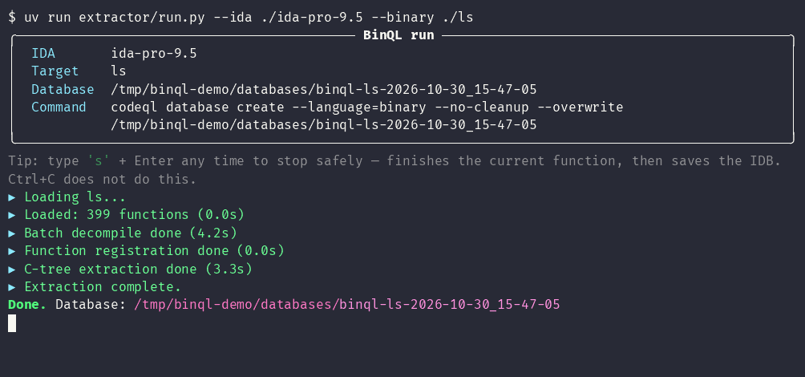
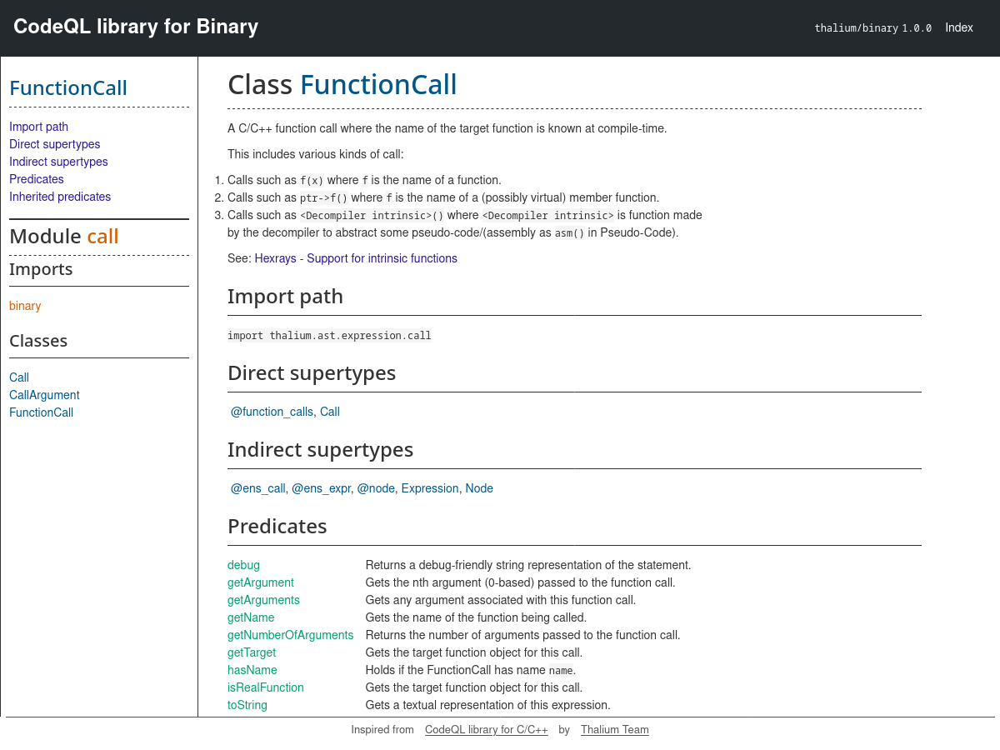

# BinQL

A **CodeQL extractor for binaries**. BinQL runs IDA Pro's Hex-Rays decompiler headless through [idalib](https://docs.hex-rays.com/user-guide/idalib) and turns the decompiled pseudocode of any binary into a **CodeQL database**, so you can hunt for bugs in firmware and closed-source executables with the same queries and tooling you use on C/C++ source. Its key features are:

* Extracting an IDA database (`.idb` / `.i64`), or a binary analyzed on the fly to a CodeQL database
* A `binary` CodeQL language whose library is modeled after the standard CodeQL library for C/C++
* Every result points back to its address in the binary, ready to jump to in IDA

<p align="center">
    <kbd>
        
    </kbd>
</p>

## Installation

Requirements:

* **IDA Pro 9.0 or later** with a Hex-Rays decompiler license, installed manually or with the [Hex-Rays CLI (hcli)](https://github.com/HexRaysSA/ida-hcli)
* **CodeQL**, from the [`codeql-bundle`](https://github.com/github/codeql-action/releases?q=%22Bundles+CodeQL%22) for Linux, with `codeql` in your `PATH` (see [Installing CodeQL](#installing-codeql))
* [**uv**](https://docs.astral.sh/uv/), `curl -LsSf https://astral.sh/uv/install.sh | sh`

Install BinQL into the CodeQL installation:

```bash
$ git clone https://github.com/thalium/binql
$ cd binql
$ uv run extractor/manage.py install
```

This copies the extractor and the `thalium/binary` library into your CodeQL installation (`binary/` and `qlpacks/` next to the `codeql` binary). Run it again after updating BinQL. All the commands below run from the repository root.

> [!NOTE]
> If a release changes the database schema (`binary.dbscheme`), databases built with older versions must be re-extracted: CodeQL refuses to run queries on them. Extracting again from the saved `.i64` is enough.

### Installing CodeQL

Download a [supported](#support) `codeql-bundle` for Linux, extract it, for example to `/opt`, and add `/opt/codeql` to your `PATH`:

```bash
$ wget https://github.com/github/codeql-action/releases/download/codeql-bundle-vX.Y.Z/codeql-bundle-linux64.tar.gz
$ sudo tar -xzf codeql-bundle-linux64.tar.gz -C /opt
$ sudo chown -R $USER:$USER /opt/codeql
$ export PATH="/opt/codeql:$PATH"
```

`manage.py install` writes into the CodeQL directory, hence the `chown`.

## Usage

### Creating a database

Give BinQL your IDA installation and a target with `--binary`, either an executable:

```bash
$ uv run extractor/run.py --ida ~/ida-pro-9.5 --binary ./ls
```

or an existing IDA database (`.i64` / `.idb`):

```bash
$ uv run extractor/run.py --ida ~/ida-pro-9.5 --binary ./ls.i64
```

IDA analyzes the binary, decompiles every function and the pseudocode is written into a new CodeQL database under `databases/`:

<p align="center">
    <kbd>
        
    </kbd>
</p>

> [!TIP]
> Extracting from an existing `.i64` keeps the work you have already done in IDA: renamed functions and variables, types and structures all end up in the database, and make queries much easier to read.

> [!NOTE]
> If the target sits in a read-only directory (`/usr/bin`, a mounted firmware image...), BinQL works on a copy inside the database directory, since IDA needs to write its database next to the input.

Several binaries are extracted in parallel with `--binaries`, one database each, as in the animation at the top of this page (`-j` sets the number of workers):

```bash
$ uv run extractor/run.py --ida ~/ida-pro-9.5 --binaries ./ls ./cat
```

Other useful options:

* `--database <dir>`, the database directory to create, instead of an automatic name
* `--no-decompile`, skip the batch decompilation pass and trust the analysis already stored in the IDB
* `-i`, interactively pick the IDA installation and the target
* `-a`, on a license mismatch, relaunch automatically with a `.hexlic` covering the binary's architecture
* `-v`, show the license table and the full extractor log

Type `s` then Enter at any time to stop cleanly: the current function finishes and the IDB is saved before exiting. `Ctrl+C` does not do this.

> [!NOTE]
> Each architecture needs its own Hex-Rays decompiler license. Point `IDA_LICENSE` to the `.hexlic` to use if your default one does not cover the target, for example `IDA_LICENSE=~/.idapro/arm_idapro.hexlic`.

### Writing queries

CodeQL only runs a query that belongs to a pack: it looks for a `qlpack.yml` in the query's directory or one of its parents, and fails if there is none. Before writing queries, create a directory for them, for example `my-queries/`, with this `qlpack.yml` declaring the dependency on `thalium/binary`:

```yaml
# my-queries/qlpack.yml
name: me/my-queries
version: 1.0.0
dependencies:
  thalium/binary: "*"
```

Put your `.ql` files in this directory (or its subdirectories). `thalium/binary` was installed into CodeQL by `manage.py install`, so no `codeql pack install` is needed.

Queries import the `binary` library. Class names follow the CodeQL library for C/C++ (`Function`, `FunctionCall`, `IfStmt`, `AssignExpr`, `Literal`...), so existing C/C++ CodeQL knowledge carries over. For example, `my-queries/memcpy.ql` finds calls to `memcpy` whose size is not a constant:

```ql
import binary

from FunctionCall call, CallArgument size
where
  call.getTarget().hasBaseName("memcpy")
  and size = call.getArgument(2)
  and not size instanceof Literal
select call.getEA() as address, call.getEnclosingFunction().getName() as caller,
  call.getTarget().getName() as callee, size.toString() as length
```

Imported functions are named with an `ext_` prefix (`ext_memcpy`), so they never clash with a local function of the same name. `hasBaseName()` and `getBaseName()` ignore the prefix, and `isExternal()` (or the `ExternalFunction` class) tells imports apart.

Run it from the command line (`-q` hides CodeQL's progress messages):

```bash
$ codeql query run -q my-queries/memcpy.ql -d databases/binql-ls-*
```

<p align="center">
    <kbd>
        
    </kbd>
</p>

Queries also run from VS Code with the [CodeQL extension](https://marketplace.visualstudio.com/items?itemName=GitHub.vscode-codeql), after adding the database.

Each result carries its address (`getEA()`): press `G` in IDA and paste it to jump to the code.

### Library documentation

The full reference of the `binary` library, with every class, predicate and its doc comment, is generated with [`codeql generate library-doc`](https://docs.github.com/en/code-security/codeql-cli/codeql-cli-manual/generate-library-doc):

```bash
$ uv run extractor/manage.py docs
```

This runs `codeql generate library-doc` on each version of the qlpack and writes a browsable HTML site to `qlpack/<version>/docs/index.html`, in the same format as the [CodeQL standard libraries](https://codeql.github.com/codeql-standard-libraries/cpp/) documentation. `uv run extractor/manage.py all` installs BinQL and generates the documentation in one go.

<p align="center">
    <kbd>
        
    </kbd>
</p>

### Limitations

BinQL queries the pseudocode, so results are only as good as the decompilation: wrong types, missing function boundaries or misidentified calls in IDA show up in the database too. Fixing them in IDA and extracting again from the `.i64` improves the results.

The `binary` library is younger than the C/C++ one. The class names match, but many convenience predicates are not implemented yet; the generic `getChild(n)`, `getLeftChild()` and `getRightChild()` accessors give access to any node's operands in the meantime.

## Future work

* **Ghidra and Binary Ninja** extractors, so the same queries run on databases built from other decompilers
* Moving the extractor to the [**IDA Domain API**](https://github.com/HexRaysSA/ida-domain), Hex-Rays' higher-level Python API
* A **proper IDA plugin**, to extract and run queries from inside IDA and jump to the results
* **Data flow**: local and global data flow and taint tracking libraries, like the `DataFlow` and `TaintTracking` modules of the C/C++ library

## Support

All architectures supported by your IDA decompiler are supported.

Supported IDA versions are **IDA Pro 9.0 to 9.5**.

Supported CodeQL bundles are [`v2.20.0` (6 December 2024)](https://github.com/github/codeql-action/releases/tag/codeql-bundle-v2.20.0) to [`v2.27.3` (20 October 2026)](https://github.com/github/codeql-action/releases/tag/codeql-bundle-v2.27.3).

## Contributing

Bug reports, queries and pull requests are welcome. See [CONTRIBUTING.md](CONTRIBUTING.md) for how to report a problem, set up a development environment and run the tests.

## License

[MIT](LICENSE)

## Credits

Thalium Team.
